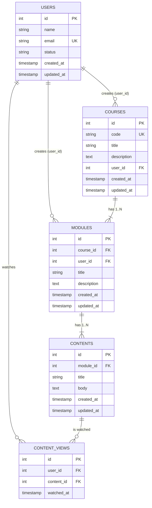

# DER (Entity-Relationship Diagram)

**Extra table:** "who watched lesson ID=2" is a many-to-many between users and contents with its own attribute (`watched_at`), so a new join table `content_views` (unique `user_id + content_id`) is used instead of extra columns.
